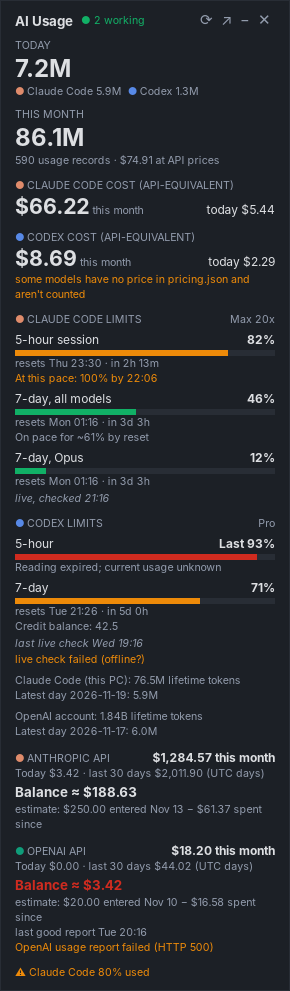

# AI Usage Tracker widget (Rust)

The desktop widget of AI Usage Tracker, rewritten from Python/tkinter as a
[Tauri 2](https://tauri.app) app: Rust for everything that decides something, and a plain
HTML/CSS/JS page that only draws. It replaces `widget.py`, `tray.py` and `startup.py`.

It targets **Windows**. It also builds and runs on Linux, which is how it was developed and
checked; the Windows-only parts are listed in the [manual test checklist](#manual-test-checklist-windows).



The hover card of "● 2 working": [docs/hover.png](docs/hover.png).

## Build on Windows

You need:

- [Rust](https://rustup.rs) (stable, the default MSVC toolchain) and the "Desktop development
  with C++" build tools it asks for;
- [Node.js](https://nodejs.org) 18 or later (only for the Tauri command line);
- the WebView2 runtime, which Windows 10 and 11 already have.

```
cd rust\widget
npm install
npm run build
```

The app is `src-tauri\target\release\AIUsageTracker.exe`: one file, no installer, copy it
anywhere. Put `pricing.json` next to it; it writes `dashboard.html` next to itself.

```
npm run dev     # run from source, rebuilding on change
npm test        # the Rust unit tests
```

The exe needs no Python: the core crates under `rust/` are plain Rust libraries. Cross-built for
`x86_64-pc-windows-gnu` on Linux, the release exe imports only Windows system DLLs and
`WebView2Loader.dll` (`objdump -p`). The MSVC build could not be tried here: after
`npm run build`, `dumpbin /dependents src-tauri\target\release\AIUsageTracker.exe` should list no
`python3.dll`.

### Run it on sample data

Whenever you work on the page, set `AIUT_FAKE_DATA` to a
file holding what `tracker.collect()` returns:

```
set AIUT_FAKE_DATA=%CD%\fixtures\sample-full.json
npm run dev
```

- `fixtures/sample-data.json`: exactly what the Python `tracker.collect()` returned for a
  throwaway home folder with made-up Claude Code and Codex logs (no logins there, so no live
  limits, no API spend and no account analytics).
- `fixtures/sample-full.json`: the same, edited so every part of the card has something to
  show: live limits with pace, an expired reading, API spend and balances, account analytics,
  two working sessions.
- `python scripts/make_fixture.py --home <throwaway folder>` rebuilds both from the Python
  original. It never reads real logs or logins and makes no network calls.

In this mode times are moved to "now" so countdowns run, nothing is read from your real logs,
no alert state is written to `%LOCALAPPDATA%\AIUsageTracker`, and "Set API balance…" saves
nothing. Without the variable the widget scans your real logs, as the Python widget did.

## What moved where

| Python | Rust / page |
|---|---|
| `widget.py`: `fmt`, `until`, `money`, the inline format rules | `src-tauri/src/format.rs` |
| `widget.py`: `show`, `_tool_cost`, `_service_limits`, `_limit_bar`, `_countdown`, `_api_section`, `_working`, `_show_working` (the wording) | `src-tauri/src/view.rs` (the view model) |
| the tkinter widgets those methods created | `ui/index.html`, `ui/style.css`, `ui/app.js` |
| `widget.py`: `_show_working` hover window | `ui/tip.html`, `place::tip_position`, `lib.rs` (`working_enter`, `tip_ready`, `track_hover`) |
| `widget.py`: `balance_dialog` | `ui/balance.html`, `lib.rs` (`balance_save`, `balance_clear`), `format::parse_amount`, `view::today_spend` |
| `widget.py`: `load_settings`, `save_settings` | `src-tauri/src/settings.rs` |
| `widget.py`: `virtual_screen`, `_start_position`, `peek` geometry, `_track_peek` test | `src-tauri/src/place.rs` |
| `widget.py`: `hide_to_tray`, `restore`, `peek`, `poll` (tray events), `refresh` guard | `src-tauri/src/lifecycle.rs` |
| `widget.py`: `refresh`, `_scan`, `auto_refresh`, `tick`, `_alerts`, menu, drag, toggles | `src-tauri/src/lib.rs` |
| `tray.py` | `src-tauri/src/tray.rs` (Tauri's tray API; no Win32 calls of our own) |
| `startup.py` | `src-tauri/src/autostart.rs` (`winreg` crate under `#[cfg(windows)]`) |
| calls into `tracker.`, `api_billing.`, `limits_watch.` | `src-tauri/src/core.rs`, and only there |
| `test_widget.py` | tests in `lifecycle.rs`, `tray.rs`, `place.rs` |
| `test_startup.py` | tests in `autostart.rs` (the registry ones run on Windows only) |

```
rust/widget/
  package.json            @tauri-apps/cli; scripts dev / build / test
  ui/                     the three pages: index.html (card), tip.html (hover card),
                          balance.html (dialog), with style.css and app.js
  fixtures/               sample-data.json, sample-full.json
  scripts/
    make_fixture.py       builds the fixtures by running the Python original on fake logs
    compare_format.py     differential check, Python widget against this one
    screenshot.sh         runs the app under xvfb and saves docs/*.png
  docs/                   widget.png, hover.png
  src-tauri/
    Cargo.toml, build.rs, tauri.conf.json, capabilities/default.json, icons/, app-icon.svg
    examples/format_cases.rs   the Rust half of compare_format.py
    src/main.rs, lib.rs, core.rs, view.rs, format.rs, lifecycle.rs, place.rs,
        settings.rs, autostart.rs, tray.rs
```

## How it fits together

Rust builds a complete **view model** from the scan: every string already worded, every colour
and bar width decided (`view::View`, sent to the page as the `screen` event). `ui/app.js` turns
it into elements and sends clicks back as commands (`press`, `drag`, `menu`, …). Nothing is
formatted or computed in the page, except that it measures its own content so the window can
take that size.

Settings stay in `%LOCALAPPDATA%\AIUsageTracker\widget.json` with the keys the Python widget
used (`x`, `y`, `topmost`, `alerts`; positions in physical pixels), so an existing file carries
over, and going back to the Python widget works too. "Start with Windows" uses the same
`AIUsageTracker` value under `HKCU\Software\Microsoft\Windows\CurrentVersion\Run` with the
same quoting, so an entry made by the Python exe is recognised and re-pointed at this exe on
first launch. The webview's own cache goes to `%LOCALAPPDATA%\AIUsageTracker\webview`.

## The seam to the core: `src-tauri/src/core.rs`

`core.rs` is the only file that calls the ported crates. Unless `AIUT_FAKE_DATA` is set, each
function there is one call:

| `core.rs` function | calls |
|---|---|
| `collect(log)` | `tracker_rs::port::native::Dirs::from_env().collect(log, api_usage, openai)`, with `api_billing_rs::port::native::api_usage` and `openai_analytics_rs::port::native::collect` |
| `write_dashboard(&data, &path)` | `tracker_rs::port::native::write_dashboard` |
| `working_now()`, `working_details()` | `Dirs::working_now(120, None)`, `Dirs::working_details(120, None)` |
| `describe_session(&info)` | `tracker_rs::port::native::describe_session` |
| `providers()`, `utc_day(now)`, `set_balance(..)` | `api_billing_rs::port::native::{PROVIDERS, utc_day, set_balance}` |
| `store_dir()`, `pace_text(..)`, `due_alerts(..)` | `limits_watch_rs::port::native::{store, pace_text, due_alerts}` |

What `collect` does that the widget relies on:

- read `pricing.json` from the folder of the exe (`core::exe_dir()`, Python's `tracker.HERE`);
- include `limits_watch.record_and_project`, as `tracker.collect` does, so windows carry
  `projection`;
- return errors as `"ExceptionName: message"`; the widget shows `Scan failed: <that>`, cut to
  60 characters.

`write_dashboard` in fake-data mode embeds `template.html` from the repository root at compile
time (the Python build also bundled it into the exe).

## Verification

Run on Linux (rustc 1.97, Tauri 2.12); nothing here was run on Windows.

| Check | Command | Result |
|---|---|---|
| Unit tests | `cargo test` in `src-tauri` | 44 passed |
| Format and lint | `cargo fmt --check`, `cargo clippy --all-targets -- -D warnings` | clean |
| Lint for Windows | `cargo clippy --target x86_64-pc-windows-gnu --all-targets -- -D warnings` | clean |
| Type-check for Windows | `cargo check --target x86_64-pc-windows-gnu` | passes |
| Link for Windows | `cargo build [--release] --target x86_64-pc-windows-gnu` | links; GUI subsystem (no console); but see the PyO3 note |
| Python against Rust | `python scripts/compare_format.py` | 51875/51875 (52275/52275 with `--seed 99 --views 400`) |
| The real window | `sh scripts/screenshot.sh` (xvfb) | `docs/widget.png`, `docs/hover.png` |

`compare_format.py` imports `widget.py` unchanged (tkinter, winreg and the tray are stubbed in
`sys.modules`) and compares, case by case, with `examples/format_cases.rs`:

- `fmt`, `until`, `money` and the inline rules (`:.0f`, `:,`, `[:60]`, the strftime patterns,
  `fromisoformat(...).astimezone()`): about 50,000 inputs with ties, negatives and boundaries;
- whole cards: `Widget.show(data)` runs against a recording stand-in for tkinter, and every
  label it creates (text and colour, in order) must equal the Rust view model's, for the
  fixtures and 1,200 randomly varied scans in four time zones.

It found one real difference while this was written: Python 3.12 and later add floats in
`sum()` with a running correction, so a month of costs could differ from a plain loop by a
cent. `format::Num::sum` now adds the same way. The other ported crates use `sum()` on floats
too (`cost_of`, `estimate_balance`, `summarize`) and need the same care.

Also exercised under xvfb with a window manager (openbox) and xdotool: left-drag moves the
window and the position lands in `widget.json`; a second start reopens there; the right-click
menu opens with the right items and ticks; "Always on top" is saved; "Set API balance…" opens
40 px below the widget's top; the hover card opens under the label, clamped to the screen, and
closes when the pointer leaves; `dashboard.html` appears next to the exe.

**Real scan.** With no `AIUT_FAKE_DATA` and `HOME` set to the fixture home that
`rust/tracker-rs/fixture/make_home.py` builds, the widget under xvfb scans those logs, shows
the totals and limits, and writes `dashboard.html` next to the binary.

## Manual test checklist (Windows)

None of this could be run on Linux. Sample data (`AIUT_FAKE_DATA`, above) shows every part of
the card at once; without it the widget scans your real logs.

Start-up and window

- [ ] Double-click the exe: no console window; one frameless dark card near the top-right, no
      taskbar button, slightly see-through, text crisp at 100%, 125% and 150% scaling.
- [ ] "Scanning…" appears first, then the card fills in and the status reads `Updated HH:MM`.
- [ ] Left-drag anywhere except the four buttons moves it. Exit and restart: it reopens there.
      `%LOCALAPPDATA%\AIUsageTracker\widget.json` holds `x` and `y`.
- [ ] Start once with a `widget.json` written by the Python widget: same place, same toggles.
- [ ] Drag it onto a second monitor, exit, unplug that monitor, start: it appears top-right of
      the primary screen.
- [ ] It stays above other windows. Right-click → Always on top (untick): other windows now
      cover it; the tick and `topmost` in `widget.json` follow; it survives a restart.

Buttons and menu

- [ ] ⟳ rescans (status `Scanning…`), ↗ opens `dashboard.html` (next to the exe) in the
      browser, ✕ quits and the tray icon goes away.
- [ ] Right-click shows: Hide to tray (keep tracking), Refresh now, Open dashboard, Set API
      balance…, Always on top, Limit alerts, Start with Windows, Exit. Each does its job.
- [ ] Delete `dashboard.html` while a scan cannot succeed, press ↗: status says
      `Dashboard not built yet — wait for the scan`.

Tray

- [ ] An "AI Usage Tracker" icon is in the notification area (maybe under ^) with the tooltip
      "AI Usage Tracker - hover to peek, click to show, right-click for menu".
- [ ] − hides the window; scans continue (watch `dashboard.html`'s modified time, 5 minutes).
- [ ] Left-click the icon: the window returns where it was. Double-click also works.
- [ ] While hidden, rest the pointer on the icon: the widget appears just above it (below it
      with the taskbar on top), on top of everything; move up into it and it stays; hover
      "● N working" there and the card of sessions opens; move away and both disappear.
- [ ] While the window is visible, hovering the icon does not move it.
- [ ] Right-click the icon: Show tracker, Refresh now, Open dashboard, Exit.
- [ ] Restart Explorer (Task Manager → Windows Explorer → Restart): the icon comes back.
- [ ] If the icon cannot be created (hard to provoke; e.g. Explorer not running), the widget
      stays visible, − is refused with "Tray icon unavailable — please try again".

Working sessions

- [ ] With a Claude Code or Codex session running, a green "● N working" shows within 30 s;
      hovering it opens the card below the label (above it near the bottom of the screen),
      inside the screen; it closes when the pointer leaves the label. (Needs working sessions, or
      the fixture.)

Limits, alerts, countdown

- [ ] Each limit shows `resets Mon 02:00 · in 10h 06m`; the "in …" part changes within 30 s
      without a rescan.
- [ ] First run on `sample-full.json`: a Windows notification "Claude Code 80% used" and the
      status line `⚠ Claude Code 80% used` in orange. Check with Focus Assist on: the status
      line still shows it. (A toast from an exe that was never installed may show without the
      app's name; if no toast appears at all, see tauri-plugin-notification's notes on app IDs.)
- [ ] Untick Limit alerts, delete `%TEMP%\AIUsageTracker-fake\limit_alerts.json`, restart: no
      notification, status `Updated HH:MM`; tick it again: nothing is replayed.

Start with Windows

- [ ] Right-click → Start with Windows: status `Will start with Windows`; `reg query
      HKCU\Software\Microsoft\Windows\CurrentVersion\Run /v AIUsageTracker` shows the exe's
      full path in double quotes; Task Manager → Startup apps lists it; sign out and in: it starts.
- [ ] Move the exe, start it from the new place: the registry value now points there.
- [ ] Untick: status `Won't start with Windows`; the value is gone.
- [ ] With the Python widget's entry present, first start of this exe re-points it.
- [ ] `cargo test` on Windows also runs the registry tests (throwaway key
      `HKCU\Software\AIUsageTrackerTest`, removed afterwards).

Set API balance…

- [ ] Opens a small always-on-top dialog 40 px below the widget's top-left. "abc" → "Enter a
      number, e.g. 25.00"; `$1,234.50` is accepted; Enter saves, Esc and the window's ✕ cancel;
      after Save or Clear the widget rescans. (Sample data saves nothing.)
